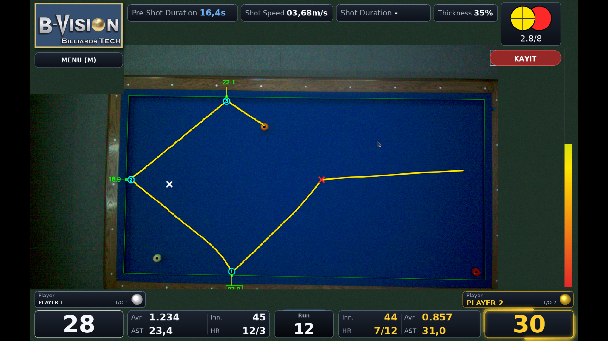

# Automated Billiards Referee — Real-Time Computer Vision on the Edge

Live screen of the camera-based automated referee for three-cushion billiards that I build as part of the team at BNCOOL-APAK. It runs fully on an NVIDIA Jetson Orin Nano mounted above the table.

*Live output: the cue ball's path with numbered cushion contacts and diamond values, hit thickness, shot speed, thinking time, shot clock and the match scoreboard. Player names are hidden.*

## What the system does

- **Detection:** YOLO11n ball detector (PyTorch / Ultralytics), exported via ONNX to an FP16 TensorRT engine for the Jetson GPU.
- **Camera geometry:** homography from camera pixels to a top-down table frame; radial lens distortion (k1, k2) calibrated from the rail diamonds (SVD line fits + Nelder-Mead).
- **Image processing:** sub-pixel Lucas-Kanade registration to measure ~0.1 px pushes on very thin contacts; spin detection from the ball's surface texture.
- **Tracking & referee logic:** per-ball motion gating and prediction (reflections, missed detections, balls hidden by the cue); shot segmentation, cushion bounces, ball-to-ball contacts, hit thickness and points.
- **Match layer:** turns, innings, 40 s shot clock with timeouts, fouls, averages and high runs; live state exported as JSON for the scoreboard.
- **Real-time pipeline:** camera capture (AR0234, 1920×1200, GStreamer), preprocessing and inference in separate threads, 25–30 FPS with no dropped frames.
- **Testing:** recorded shots, a labeled shot set and a replay mode that compares referee decisions to the labels, plus unit tests.

The source code belongs to the company and is not public; this page only shows the result.

**Muhammet Ali Başar** · [LinkedIn](https://linkedin.com/in/alibasar00)
